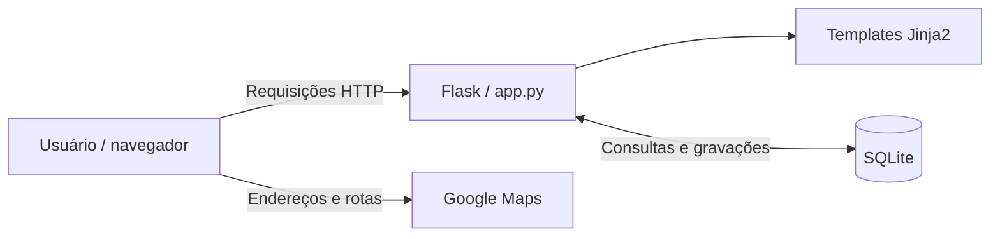
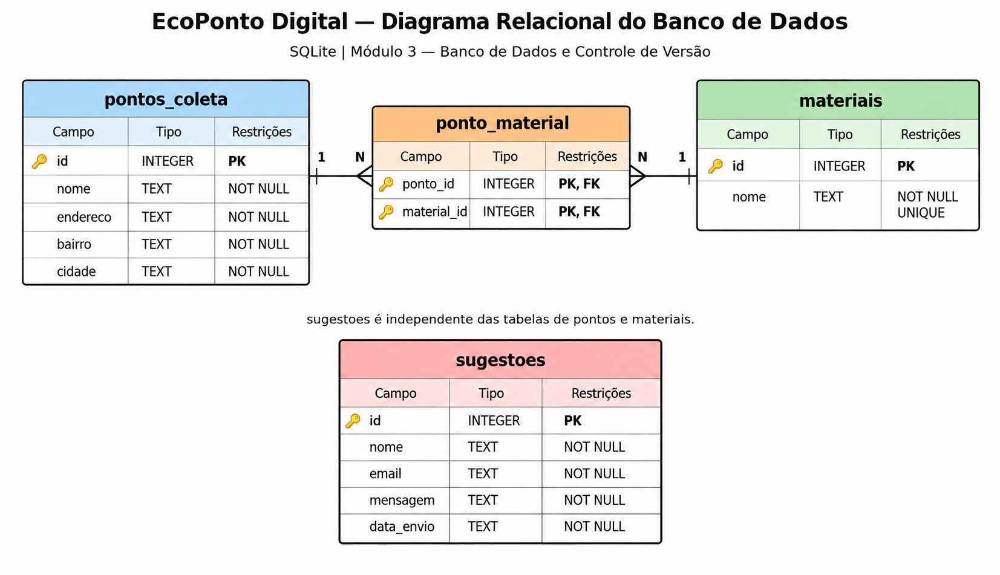

# EcoPonto Digital

[](https://github.com/fabricioalan-ufms/ecoponto-digital/actions/workflows/ci.yml)


Aplicação web para consulta de **pontos demonstrativos de recebimento de resíduos eletroeletrônicos**, pesquisa de materiais e acesso a informações sobre descarte responsável.

Desenvolvida ao longo dos **Projetos Integradores de Tecnologia da Informação I, II e III** da **Universidade Federal de Mato Grosso do Sul (UFMS)**, com foco na comunidade de **Sonora - MS**.

**[Acessar aplicação online](https://fabricioalanufms.pythonanywhere.com/)** · **[Código-fonte](https://github.com/fabricioalan-ufms/ecoponto-digital)** · **[Execuções do CI](https://github.com/fabricioalan-ufms/ecoponto-digital/actions/workflows/ci.yml)**

> **Projeto demonstrativo.** Os pontos exibidos não foram validados como locais oficiais de recebimento. Endereços e materiais associados não devem ser usados como confirmação de que um estabelecimento recebe resíduos eletrônicos.

## Visão geral

O EcoPonto Digital é um *Minimum Viable Product* (MVP) desenvolvido para reunir informações educativas sobre resíduos de equipamentos eletroeletrônicos (REEE) em uma interface web acessível. A proposta foi motivada pela dificuldade de encontrar, em um único lugar, orientações de descarte, materiais aceitos e informações sobre pontos de recebimento.

O sistema utiliza **Flask** para processamento das requisições, **Jinja2, HTML, CSS e Bootstrap** para a interface e **SQLite** para persistência das informações. A integração com o Google Maps permite consultar a localização dos endereços cadastrados.

## Funcionalidades

| Recurso | Descrição |
| --- | --- |
| Pontos demonstrativos | Listagem dos locais cadastrados, endereços e materiais associados. |
| Pesquisa | Busca por nome, endereço, bairro, cidade ou material. |
| Materiais | Consulta dos tipos de materiais vinculados a cada ponto. |
| Mapas | Acesso a endereços e rotas por meio do Google Maps. |
| Orientações | Conteúdo educativo sobre descarte, logística reversa e cuidados com dados pessoais. |
| FAQ | Respostas a perguntas frequentes. |
| Sugestões | Formulário com validação de campos obrigatórios e registro em SQLite. |
| Responsividade | Interface adaptável a telas de computadores e dispositivos móveis. |

O projeto não é um diretório oficial de coleta nem substitui informações fornecidas por órgãos públicos ou operadores de logística reversa.

## Tecnologias e ferramentas

| Camada | Tecnologias |
| --- | --- |
| Back-end | Python 3, Flask |
| Front-end | HTML5, CSS3, Bootstrap, Jinja2 |
| Banco de dados | SQLite |
| Integração externa | Google Maps |
| Qualidade | `unittest`, `unittest.mock`, Flask `test_client` |
| Versionamento | Git, GitHub |
| Integração contínua | GitHub Actions |
| Hospedagem | PythonAnywhere |

## Arquitetura

A aplicação segue uma organização simples: o navegador acessa as rotas Flask, que renderizam os templates e consultam o banco de dados quando necessário. Os links do Google Maps são recursos externos à aplicação.



**Rotas principais**

| Método | Rota | Finalidade |
| --- | --- | --- |
| GET | `/` | Página inicial. |
| GET | `/pontos` | Consulta aos pontos demonstrativos. |
| GET | `/pontos?busca=pilhas` | Exemplo de pesquisa por termo. |
| GET | `/orientacoes` | Informações educativas. |
| GET | `/faq` | Perguntas frequentes. |
| GET / POST | `/sugestoes` | Exibição e processamento do formulário. |

As consultas realizadas com termos fornecidos pelo usuário utilizam parâmetros SQL, em vez de concatenar diretamente esses valores às instruções de consulta.

## Banco de dados

O esquema relacional é composto por quatro tabelas:

| Tabela | Finalidade |
| --- | --- |
| `pontos_coleta` | Armazena os pontos demonstrativos, seus nomes e endereços. |
| `materiais` | Catálogo dos tipos de materiais. |
| `ponto_material` | Tabela associativa do relacionamento muitos-para-muitos entre pontos e materiais. |
| `sugestoes` | Armazena nome, e-mail, mensagem e data das sugestões recebidas. |

As tabelas `pontos_coleta` e `materiais` possuem relacionamento N:N, implementado por `ponto_material` com chaves estrangeiras. O esquema utiliza integridade referencial e `ON DELETE CASCADE` para os vínculos dessa associação.

<details>
<summary>Visualizar o diagrama relacional</summary>



</details>

Os scripts de estrutura e de dados demonstrativos encontram-se em `database/`. O arquivo `ecoponto.db` é gerado no ambiente de execução e **não deve ser publicado quando contiver informações de usuários**.

## Estrutura do repositório

```text
ecoponto-digital/
├── .github/
│   └── workflows/
│       └── ci.yml
├── database/
│   ├── schema.sql
│   ├── dados_iniciais.sql
│   ├── operacoes_crud.sql
│   ├── demonstrar_crud.py
│   └── demonstrar_relacionamentos.py
├── docs/
│   └── diagrama_banco.png
├── static/
│   └── css/
│       └── style.css
├── templates/
│   ├── index.html
│   ├── pontos.html
│   ├── orientacoes.html
│   ├── faq.html
│   └── sugestoes.html
├── tests/
│   └── test_ecoponto.py
├── .gitignore
├── app.py
├── requirements.txt
└── README.md
```

A pasta `database/` contém o esquema SQL, registros demonstrativos e exemplos de operações CRUD. Os arquivos em `docs/` e `tests/` documentam, respectivamente, o modelo de dados e verificações automatizadas da aplicação.

## Execução local

**Pré-requisitos:** Python 3, `pip` e Git.

No **PowerShell do Windows**, execute:

```powershell
git clone https://github.com/fabricioalan-ufms/ecoponto-digital.git
cd ecoponto-digital
python -m venv .venv
.\.venv\Scripts\Activate.ps1
python -m pip install -r requirements.txt
python app.py
```

Abra **http://127.0.0.1:5000/** no navegador. A execução local por `python app.py` inicializa o SQLite e insere os registros demonstrativos quando necessário.

Caso a ativação do ambiente virtual seja bloqueada no PowerShell, use `Set-ExecutionPolicy -Scope Process -ExecutionPolicy Bypass` na sessão atual e tente novamente.

**Observação:** em servidores WSGI, a inicialização do banco deve ser feita separadamente. A instalação local com o servidor de desenvolvimento Flask não equivale a uma configuração de produção.

## Testes e integração contínua

O EcoPonto Digital possui **oito testes automatizados**, construídos com `unittest` e o cliente de testes do Flask. Cada teste utiliza um banco SQLite temporário, sem modificar a base principal.

| Caso | Verificação |
| --- | --- |
| 01 | Carregamento das cinco páginas principais. |
| 02 | Existência dos três pontos demonstrativos iniciais. |
| 03 | Pesquisa pelo termo `pilhas`. |
| 04 | Pesquisa pelo termo `computadores`. |
| 05 | Tratamento de pesquisa sem resultados. |
| 06 | Rejeição de formulário com campos obrigatórios vazios. |
| 07 | Processamento e persistência de uma sugestão válida. |
| 08 | Integridade das chaves estrangeiras e dos relacionamentos. |

Para executar a suíte localmente, na raiz do projeto:

```powershell
python -m unittest discover -s tests -p "test_*.py" -v
```

Também foram realizados **12 testes funcionais manuais no Projeto Integrador II**, abrangendo navegação, pesquisas, sugestões, responsividade e links externos. Os 20 testes foram aprovados nos cenários e nas execuções acadêmicas registrados; isso não representa garantia de ausência de falhas em outros ambientes.

### GitHub Actions

O workflow [`.github/workflows/ci.yml`](.github/workflows/ci.yml) executa verificações automaticamente em alterações na branch `main` e em *pull requests*, além de permitir execução manual. O processo contempla:

1. Preparação do ambiente Python.
2. Instalação de dependências.
3. Verificação sintática dos arquivos Python.
4. Execução dos testes automatizados.
5. Registro do resultado na aba [Actions](https://github.com/fabricioalan-ufms/ecoponto-digital/actions).

O indicador **CI** no início deste README acompanha os resultados do workflow executado na branch `main`. A automação de testes está implementada; as demais práticas de entrega contínua estudadas no Projeto Integrador III permanecem como propostas de evolução.

## Evolução acadêmica

| Etapa | Trabalho desenvolvido |
| --- | --- |
| **Projeto Integrador I** | Identificação da problemática, planejamento da solução e levantamento inicial de requisitos. |
| **Projeto Integrador II** | Desenvolvimento do MVP, requisitos funcionais e não funcionais, modelagem relacional, documentação, versionamento e testes. |
| **Projeto Integrador III** | Inspeção de requisitos e arquitetura, correções técnicas e documentais, plano de testes, plano de desenvolvimento seguro e plano de CI/CD. |

Na inspeção do PI III, foram examinados **14 requisitos** e catalogados **12 apontamentos** de documentação, requisitos e arquitetura. Foram realizadas correções e reexecutada a suíte de oito testes, com aprovação nos cenários cobertos.

Os planos acadêmicos de testes, segurança e CI/CD apresentam propostas graduais: **não significam que todos os controles, testes adicionais ou mecanismos de entrega tenham sido implementados**.

### Levantamento exploratório

A definição do problema também contou com um formulário exploratório que registrou **42 respostas**, das quais **32 declararam residência em Sonora - MS**. Entre esse recorte local, 75% informaram não conhecer um ponto de recebimento de lixo eletrônico no município, e 84,4% consideraram útil ou muito útil uma solução digital que concentrasse informações sobre descarte e recebimento.

Os resultados contribuíram para orientar o escopo do MVP. Por se tratar de um levantamento exploratório, não representam uma estimativa estatística para toda a população do município.

## Disponibilização pública e limitações

**Demonstração online:** https://fabricioalanufms.pythonanywhere.com/

O GitHub mantém o código-fonte; a aplicação Flask é executada no **PythonAnywhere**. O GitHub Pages isoladamente não executa o back-end Python nem as operações SQLite da aplicação.

O site público permanece uma **demonstração acadêmica**. Antes de ampliar sua utilização, é necessário considerar a validação oficial dos locais cadastrados, a política de privacidade das sugestões, o controle de envios repetitivos, backups do banco e o gerenciamento de segredos e configurações do servidor.

Não há painel administrativo nem cadastro público de novos pontos nesta versão. A presença do formulário de sugestões não implica revisão ou publicação automática de informações enviadas por usuários.

## Próximas melhorias

- Validação dos locais e materiais junto aos responsáveis pelos pontos de recebimento.
- Ampliação dos testes de compatibilidade, acessibilidade, usabilidade e segurança.
- Reforço da proteção e do tratamento das sugestões enviadas.
- Documentação e automação gradual do empacotamento e da entrega de versões.
- Evolução da estrutura de hospedagem e de backup para necessidades futuras.

## Autor

**Fabricio Alan Rocha**  
Graduando em Tecnologia da Informação — Universidade Federal de Mato Grosso do Sul (UFMS).

[Repositório](https://github.com/fabricioalan-ufms/ecoponto-digital) · [Aplicação online](https://fabricioalanufms.pythonanywhere.com/)
